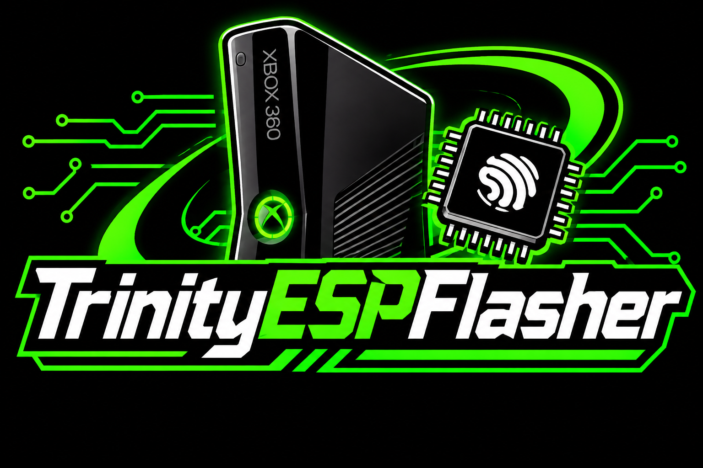
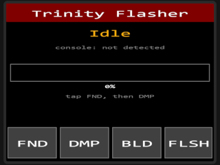
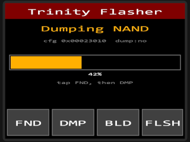
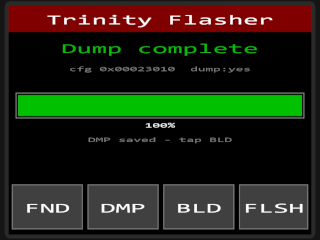
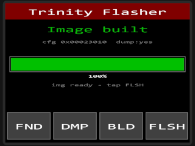

 <p align="center">
  
</p>

<p align="center">    
</p>


# TrinityESPFlasher (+ TrinityWeb360)

An **Xbox 360 Slim (Trinity) NAND flasher** that runs entirely on an
**ESP32-S3** with a 2.4" touch screen. Detect the console, dump the NAND, build
an RGH/glitch image from the xeBuild data package on a microSD card, and flash
it back, all from on-screen buttons. An optional WiFi web UI runs alongside the
touch screen, but the touch screen is the primary interface and works with no
network at all.

> **Status: work in progress. Read [Project status](#project-status) and
> [Known issues](#known-issues) before flashing anything.** The image builder
> is verified on a PC against real J-Runner images, but the console link on the
> built hardware does not work yet.

---

## Features

- **On-screen touch UI** (320x240 ILI9341 + XPT2046): four buttons, status line,
  console info line, progress bar, and a hint line telling you the next step.
- **Detect**: stops the SMC and reads the NAND flash config to confirm wiring.
- **Dump**: reads the whole NAND twice and compares the two reads.
- **Build**: re-targets a finished RGH3 image on the SD card (`RGH3BASE.BIN`)
  at the console you dumped: its KeyVault, SMC config and per-console files.
- **Flash**: writes the built image and reads it back to verify (only if the
  build passed its self-check).
- **Optional WiFi web UI**: the same Detect / Dump / Build / Flash flow from a
  browser, with live progress. Joins your network, or falls back to its own
  access point.
- **microSD** holds the base image, your CPU key, the dump and the built image.

---

## Hardware

**Board:** ESP32-S3-DevKitC-1 **N16R8** (16 MB flash / 8 MB octal PSRAM).

You also need a 2.4" ILI9341 SPI LCD with XPT2046 resistive touch, an SPI
microSD breakout (the common "V474"-style 3.3 V board) with a microSD card, and
dupont wires plus soldering gear for the console's J2C1 header.

All logic is **3.3 V on both sides, so no level shifting.** A **common ground is
mandatory.**

### Three separate buses

| Bus | Used for | Type |
|---|---|---|
| SPI2 | Xbox 360 southbridge (J2C1) | Hardware SPI, isolated |
| SPI3 | microSD card | Hardware SPI, SD only |
| Software SPI | LCD + touch | Bit-banged on its own pins |

The S3 has only two usable hardware SPI hosts besides flash/PSRAM, so the LCD
and touch controller share a bit-banged bus instead of sharing the SD bus.

### Xbox 360 Trinity: J2C1 header

These are the same points the RP2040 PicoFlasher uses.

Wire in this order (GPIO10 → 21, then GND last):

| ESP32-S3 GPIO | J2C1 signal | Wire color | Notes |
|---|---|---|---|
| GPIO10 | SPI_SS_N | 🟤 Brown | chip select |
| GPIO11 | SPI_MOSI | 🔴 Red | ESP to SB data |
| GPIO12 | SPI_CLK | 🟠 Orange | clock |
| GPIO13 | SPI_MISO | 🟡 Yellow | SB to ESP data |
| GPIO14 | SMC_DBG_EN | 🟢 Green | SMC debug enable |
| GPIO21 | SMC_RST_XDK_N | 🔵 Blue | SMC reset |
| GND | GND | 🟣 Purple | **required — connect last** |

### microSD card (SPI3)

| ESP32-S3 GPIO | SD module pin |
|---|---|
| GPIO4 | CS |
| GPIO5 | CLK |
| GPIO6 | MOSI |
| GPIO7 | MISO |
| 3V3 | 3v3 |
| GND | GND |

### LCD + touch (software SPI)

| ESP32-S3 GPIO | Goes to |
|---|---|
| GPIO39 | LCD SCK + touch CLK (shared clock) |
| GPIO40 | LCD MOSI + touch DIN (shared data out) |
| GPIO41 | touch DO (data in; the LCD is write-only) |
| GPIO15 | LCD CS |
| GPIO16 | LCD DC |
| GPIO17 | LCD RST |
| GPIO18 | LCD LED (backlight) |
| GPIO8 | touch CS (T_CS) |
| GPIO9 | touch IRQ (T_IRQ) |
| 3V3 | LCD VCC + touch VCC |
| GND | all grounds |

> **Keep clear:** GPIO35/36/37 are used by the N16R8's octal PSRAM. GPIO19/20
> are native USB and reserved for a possible future USB mode. GPIO0, 45 and 46
> are strapping pins and are avoided.

All pins are defined in [`main/pins.h`](main/pins.h); change them there if your
board differs. Touch calibration (`RAW_X_MIN/MAX`, `RAW_Y_MIN/MAX`, `SWAP_XY`,
`INVERT_X`, `INVERT_Y`) lives in [`main/touch.c`](main/touch.c); adjust it if
taps land off-target on your panel.

---

## The microSD card

Format the card **FAT32** and put this on it:

```
/RGH3BASE.BIN            required for BLD: a finished RGH3 image (see below)
/cpukey.txt              recommended: the target console's CPU key
/xell/TRINITY_RGH3.ecc   required for XEL only (from J-Runner common/xell-images/glitch2)
/xell/xell-gggggg.bin    optional for XEL: newer XeLL (from J-Runner xeBuild/data)
```

- **`RGH3BASE.BIN`** is the image the builder re-targets. Take the
  `updflash.bin` that J-Runner built for a Trinity with the patch set you want
  (16 MB, 17,301,504 bytes) and copy it to the card under this name. It is
  Microsoft-derived and holds a KeyVault, so it is **not distributed here** and
  should not be shared. Every image the tool builds has that same dashboard
  version and patch set.
- **`cpukey.txt`**: the *target* console's key; extra text around it is fine,
  the first 32 hex characters are used. With it, the builder refuses a dump
  whose KeyVault the key cannot authenticate, and can regenerate
  `secdata.bin`/`extended.bin`. Without it the KeyVault is copied unchecked.
  The key **cannot be computed from a NAND dump**; XEL + KEY read it off the
  console.

The tool writes `NANDDUMP.BIN`, `BACKUP.BIN` (two copies of the verified dump),
`IMAGE.BIN` (the built image) and `XELL.ECC` to the card root. Keep the dumps.

**Build self-test:** copy a NAND read of the console to the card as both
`NANDDUMP.BIN` and `BACKUP.BIN`, and the image you expect (made on a PC with
[`tools/host_build.c`](tools/host_build.c)) as `REFIMG.BIN`. BLD then ends with
**Image = REFIMG** if the device built it byte for byte. Delete `REFIMG.BIN`
afterwards; while it is on the card any build that differs from it is refused.

---

## Build and flash the firmware

You do this once, to put the tool onto the ESP32.

### ESP-IDF (recommended)

Install **ESP-IDF v5.3.x** (the firmware is built and tested against v5.3.1). On Windows use the
[ESP-IDF Windows Installer](https://dl.espressif.com/dl/esp-idf/) and open the
**ESP-IDF PowerShell** shortcut it creates. On Linux/macOS run `./install.sh
esp32s3` and `. ./export.sh` in your ESP-IDF checkout.

```
git clone https://github.com/xxxtrippy/TrinityESPFlasher.git
cd TrinityESPFlasher
idf.py set-target esp32s3
idf.py build
idf.py -p COM5 flash monitor        # use your own port
```

Find your port in Device Manager (Windows, `COMx`), or `/dev/ttyACM0` /
`/dev/ttyUSB0` (Linux), or `/dev/cu.usbmodem*` (macOS). Press `Ctrl+]` to leave
the monitor. If flashing won't start, hold **BOOT**, tap **RST**, release
**BOOT**, and retry.

[`sdkconfig.defaults`](sdkconfig.defaults) already sets 16 MB flash, octal PSRAM
at 80 MHz, the custom partition table, and a larger main-task stack. The
partition table ([`partitions.csv`](partitions.csv)) gives the app a 3 MB
`factory` partition.

### PlatformIO

A `platformio.ini` is included (`esp32-s3-n16r8` environment) as an alternative,
but ESP-IDF is the primary path.

---

## WiFi and the web UI (optional)

The web UI is a thin layer over the same job engine the touch screen uses. If
you don't want it, ignore it; the touch UI is started first and works
regardless.

**Set your network before building.** Edit `STA_SSID` and `STA_PASS` in
[`main/wifi.c`](main/wifi.c). Do not commit real credentials to a public repo.

- **Station mode (default):** the board joins your WiFi, then pins its address
  to **x.x.x.250** on whatever subnet your router gave it (change
  `STATIC_HOST_OCTET`, or set it to `0` for plain DHCP). The final IP is printed
  to the serial monitor on boot.
- **Fallback access point:** if it can't join after 8 retries (or 20 s), it
  starts its own network, **`TrinityFlasher`** (password **`flash360`**), and the
  UI is at `http://192.168.4.1/`.

| Endpoint | Method | Purpose |
|---|---|---|
| `/` | GET | the web app |
| `/api/detect` | GET | stop SMC, read flash config |
| `/api/sd` | GET | check for the xeBuild package on the SD card |
| `/api/dump` | POST | start a NAND dump |
| `/api/build` | POST | start a build (optional JSON `{"cpu_key": "..."}`, otherwise `cpukey.txt`) |
| `/api/flash` | POST | start a flash |
| `/api/progress` | GET | live progress (server-sent events) |

There is no authentication. Only run it on a network you trust.

---

## Using it

1. Put `RGH3BASE.BIN` (and `cpukey.txt`) on the microSD card and insert it.
2. Power the console to **standby** (the ESP can run from the console's 3.3 V
   standby rail or from its own USB; grounds must be common).
3. Tap through the buttons on the screen:

| Button | Action |
|---|---|
| **FND** | Find/detect: stops the SMC and reads the flash config. The info line shows `cfg 0x........` on success, or `console: not detected`. |
| **DMP** | Dump: reads the NAND twice and compares. Ends green on a match, red with `reads differ - check wiring` on a mismatch. |
| **XEL** | Stock console only: writes an RGH3 XeLL image with this console's KeyVault so it boots XeLL. |
| **KEY** | Stock console only: reads the CPU key from XeLL over WiFi into `cpukey.txt`. |
| **BLD** | Build: checks the dump and `RGH3BASE.BIN`, authenticates the KeyVault with the CPU key if there is one, and writes `IMAGE.BIN`. Needs only the SD card, so it works without a console link once `NANDDUMP.BIN` + `BACKUP.BIN` are on the card. |
| **FLSH** | Flash: writes `IMAGE.BIN` and reads it back. Does nothing unless a build passed its self-check. |


<p align="center">
   
   
</p>

The web UI offers the same flow, plus a box to type your CPU key instead of
using `cpukey.txt`.
---

## Project status

| Part | State |
|---|---|
| Image builder (`build_image.c`, `flashfs.c`) | **Host-verified against real J-Runner images** (`tools/test_build_image.c`) with two different bases (plain XL HDD and one with extra kernel patches): rebuilding an image from itself is byte-identical; a re-target from a NAND read-back changes only per-console pages. Not yet booted on a second console. |
| NAND spare **ECC** (`nand_ecc.c`) | **Verified**: all 32768 pages of real 16 MB images. |
| KeyVault / `secdata.bin` / `extended.bin` crypto | **Verified** against real files and their CPU key. |
| SB SPI register protocol (`spiex.c`), NAND read/erase/write (`xbox.c`), SMC stop/start | Ported from PicoFlasher. **Not working on the bench yet** — see Known issues. |
| Detect, streamed two-pass dump to SD, flash + read-back verify | Implemented; blocked by the link problem above. |
| XEL (write RGH3 XeLL) and KEY (CPU key over WiFi) | Implemented, not bench-tested. |
| Touch UI, microSD, WiFi + web UI | Implemented. |

How the builder works and what is per-console: [`RGH3_BUILD_MODEL.md`](RGH3_BUILD_MODEL.md).

---

## Known issues

- **The console link is not working yet.** On the built unit, FND reads flash
  config `0x00000000` where PicoFlasher on the same console reads
  `0x00023010`. The register protocol and the SMC handshake match PicoFlasher,
  so the cause is likely electrical. FND now holds CLK/MOSI low during the
  handshake, re-arms SS as an output, and retries three times with a slower
  clock each time. When it still fails the info line shows
  `nolink AABB CCCCCCCC w=SCOIDR D?R?`:
  - `AABB` is what MISO showed while the command was sent and `CCCCCCCC` the
    value read. `0000 00000000` or `FFFF FFFFFFFF` means nothing answered.
  - `w=` is each wire released and probed in the order SS, CLK, MOSI, MISO,
    DBG_EN, RST: `F` floats (not connected, or the far end is hi-Z), `L` held
    low, `H` held high by the console. The SMC reset line has a pull-up on the
    console, so the last letter should be `H`; an `F` there means the RST wire
    does not reach the board.
  - `D1R1` are the DBG_EN / RST pads read back while driven; a `0` means that
    pad is being pulled low externally.

  The hint line under the progress bar shows the SD card state (`SD: no card
  found`, `SD: not FAT32 (exFAT?) - reformat`, `SD ok - no NANDDUMP.BIN on it`,
  `SD: dump ready`, ...), and the bottom line shows the firmware tag.

  Two quick tests split the problem in half:
  1. **ESP side (console unplugged):** jumper GPIO11 (MOSI) to GPIO13 (MISO) and
     tap FND. `loopback OK: ESP pins work` proves the ESP drives and reads the
     bus correctly.
  2. **SMC halt (console in standby, wired):** tap FND, then press the console's
     power button. A halted SMC ignores the button. If the console powers on,
     the handshake did not take: look at the DBG_EN, RST and SS wires. If it
     stays off, the SMC is halted and the fault is on CLK, MOSI or MISO.
- **Bad blocks are not handled.** The builder refuses a dump whose KeyVault or
  config blocks are remapped, and Flash stops on the first write error. Use
  J-Runner for a console with bad blocks.
- **Re-targeting at another console is untested on hardware.** If that
  console's dump has no `crl.bin`/`dae.bin`/`fcrt.bin`, the base's copies stay
  in the image.
- **One dashboard/patch set per card**: whatever `RGH3BASE.BIN` was built with.
- **WiFi credentials are hardcoded** in `main/wifi.c`; set your own and keep
  them out of commits.

---

## Safety

- Keep your first dump. It holds your keyvault and is the only way back if
  something goes wrong.
- Dump twice and compare. A single bad bit in a NAND image matters.
- Never patch around the verification gates to force a flash.
- For use on a console you own.

---

## Project layout

| File | Purpose |
|---|---|
| `main/main.c` | Entry point: initializes everything, starts the UI, WiFi, and web server |
| `main/ui.c` | Touch UI layout, drawing, and button handling |
| `main/jobs.c` | Shared worker for dump / build / flash and CPU-key loading |
| `main/xbox.c`, `main/spiex.c` | Xbox southbridge SPI and NAND access |
| `main/build_image.c` | Image builder and its self-check |
| `main/flashfs.c` | Read-only NAND filesystem access (finds per-console files in a dump) |
| `main/nand_ecc.c`, `main/xenon_keys.c`, `main/nand_geom.h` | ECC, key/secret extraction, NAND geometry |
| `tools/test_build_image.c`, `tools/host_build.c` | PC test of the builder against your own J-Runner files; the builder as a PC command |
| `main/lcd.c`, `main/touch.c`, `main/softspi.c`, `main/font8x8.h` | Display, touch, and the bit-banged SPI bus |
| `main/sdcard.c`, `main/board_spi.c` | microSD mount and the SD SPI bus |
| `main/wifi.c`, `main/web_server.c`, `main/web_index.h` | Optional WiFi and web UI |
| `main/pins.h` | All pin assignments |
| `partitions.csv`, `sdkconfig.defaults`, `platformio.ini` | Build configuration |

[`WALKTHROUGH.md`](WALKTHROUGH.md) has a longer step-by-step guide.

---

## License and credits

GPL-3.0 (see [LICENSE](LICENSE)). Attribution is in [NOTICE](NOTICE). The SB SPI
protocol and NAND command sequences are derived from
[GxOSS/espflasher](https://github.com/GxOSS/espflasher) and
[balika011/PicoFlasher](https://github.com/balika011/PicoFlasher). The xeBuild
data package is not included and must be supplied by the user.

## USB-host mode: drive a PicoFlasher over USB-C (fw 1116u+)

Instead of wiring the ESP's own six SB lines to the console, the ESP32-S3 can be
a **USB host** and drive a PicoFlasher that is already hard-wired to the Xbox.
The PicoFlasher does all the SB timing; the ESP just sends it the same commands
J-Runner would. This removes the fragile SB connection entirely.

**Wiring:** ESP32-S3 native USB-C port → USB-OTG cable → PicoFlasher's USB-C.
The ESP must power the PicoFlasher, and most S3 boards do not output 5 V on the
OTG port, so use an OTG cable that also takes external 5 V (or a powered hub) and
feed it from a phone charger. Flash the ESP firmware over the **other** USB-C
port (the UART/COM one), since the native port is now the host.

**Use:** with the PicoFlasher plugged in, the info line shows
`USB: PicoFlasher v3` once it enumerates. Tap **FND**: the ESP asks the
PicoFlasher for the flash config, so a good link shows `cfg 0x00023010`. DMP,
BLD and FLSH then run through the PicoFlasher automatically. If no PicoFlasher is
present, FND falls back to the ESP's direct SB wiring as before.

Code: `main/picolink.c` (raw USB-host CDC client) and the `s_use_pico` backend
switch in `main/jobs.c`.
