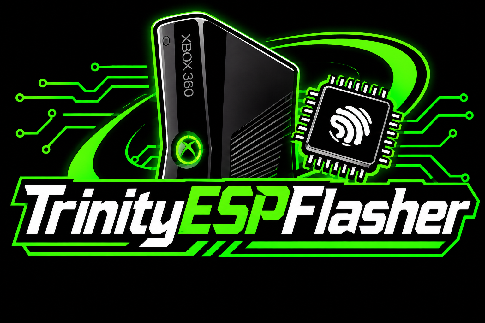
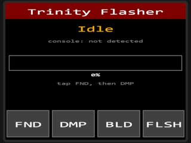
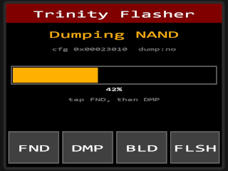
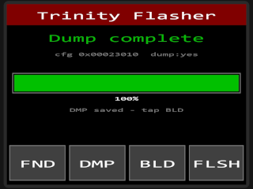
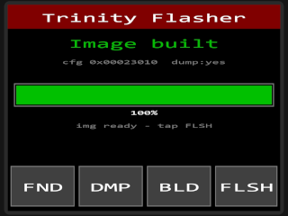

 <p align="center">
  
</p>

<p align="center">    
</p>


# TrinityESPFlasher (+ TrinityWeb360)

An **Xbox 360 Slim (Trinity) NAND flasher** that runs entirely on an
**ESP32-S3** with a 2.4" touch screen. Detect the console, dump the NAND, build
an RGH/glitch image from the xeBuild data package on a microSD card, and flash
it back, all from on-screen buttons. An optional WiFi web UI runs alongside the
touch screen, but the touch screen is the primary interface and works with no
network at all.

> **Status: work in progress. Read [Project status](#project-status) and
> [Known issues](#known-issues) before flashing anything.** The image build is
> wired end-to-end but deliberately gated off until it is verified on real
> hardware, so the firmware refuses to flash an unverified image.

---

## Features

- **On-screen touch UI** (320x240 ILI9341 + XPT2046): four buttons, status line,
  console info line, progress bar, and a hint line telling you the next step.
- **Detect**: stops the SMC and reads the NAND flash config to confirm wiring.
- **Dump**: reads the whole NAND twice and compares the two reads.
- **Build**: assembles an RGH image from your dump, your CPU key, and the
  xeBuild data package on the SD card (gated, see below).
- **Flash**: writes a built image back to the NAND (only if the build passed
  its verification gates).
- **Optional WiFi web UI**: the same Detect / Dump / Build / Flash flow from a
  browser, with live progress. Joins your network, or falls back to its own
  access point.
- **microSD support** for the xeBuild data package and your CPU key.

---

## Hardware

**Board:** ESP32-S3-DevKitC-1 **N16R8** (16 MB flash / 8 MB octal PSRAM).

You also need a 2.4" ILI9341 SPI LCD with XPT2046 resistive touch, an SPI
microSD breakout (the common "V474"-style 3.3 V board) with a microSD card, and
dupont wires plus soldering gear for the console's J2C1 header.

All logic is **3.3 V on both sides, so no level shifting.** A **common ground is
mandatory.**

### Three separate buses

| Bus | Used for | Type |
|---|---|---|
| SPI2 | Xbox 360 southbridge (J2C1) | Hardware SPI, isolated |
| SPI3 | microSD card | Hardware SPI, SD only |
| Software SPI | LCD + touch | Bit-banged on its own pins |

The S3 has only two usable hardware SPI hosts besides flash/PSRAM, so the LCD
and touch controller share a bit-banged bus instead of sharing the SD bus.

### Xbox 360 Trinity: J2C1 header

These are the same points the RP2040 PicoFlasher uses.

| ESP32-S3 GPIO | J2C1 signal | Notes |
|---|---|---|
| GPIO10 | SPI_SS_N | chip select |
| GPIO12 | SPI_CLK | clock |
| GPIO13 | SPI_MISO | SB to ESP data |
| GND | GND | **required** |
| GPIO21 | SMC_RST_XDK_N | SMC reset |
| GPIO14 | SMC_DBG_EN | SMC debug enable |
| GPIO11 | SPI_MOSI | ESP to SB data |

### microSD card (SPI3)

| ESP32-S3 GPIO | SD module pin |
|---|---|
| GPIO4 | CS |
| GPIO5 | CLK |
| GPIO6 | MOSI |
| GPIO7 | MISO |
| 3V3 | 3v3 |
| GND | GND |

### LCD + touch (software SPI)

| ESP32-S3 GPIO | Goes to |
|---|---|
| GPIO39 | LCD SCK + touch CLK (shared clock) |
| GPIO40 | LCD MOSI + touch DIN (shared data out) |
| GPIO41 | touch DO (data in; the LCD is write-only) |
| GPIO15 | LCD CS |
| GPIO16 | LCD DC |
| GPIO17 | LCD RST |
| GPIO18 | LCD LED (backlight) |
| GPIO8 | touch CS (T_CS) |
| GPIO9 | touch IRQ (T_IRQ) |
| 3V3 | LCD VCC + touch VCC |
| GND | all grounds |

> **Keep clear:** GPIO35/36/37 are used by the N16R8's octal PSRAM. GPIO19/20
> are native USB and reserved for a possible future USB mode. GPIO0, 45 and 46
> are strapping pins and are avoided.

All pins are defined in [`main/pins.h`](main/pins.h); change them there if your
board differs. Touch calibration (`RAW_X_MIN/MAX`, `RAW_Y_MIN/MAX`, `SWAP_XY`,
`INVERT_X`, `INVERT_Y`) lives in [`main/touch.c`](main/touch.c); adjust it if
taps land off-target on your panel.

---

## The microSD card

Format the card **FAT32** and put this on it:

```
/cpukey.txt              <- your CPU key (first 32 hex characters are used)
/xebuild/data/
    cb.bin               required
    cbb.bin              required
    cd.bin               required
    ce.bin               required
    patches.bin          required
    smc.bin              required
    smc_config.bin       optional
    xell-reloaded.bin    optional (first-boot CPU key reader)
```

- **`cpukey.txt`**: extra text around the key is fine; the firmware picks out
  the first 32 hex characters. On a first RGH install the CPU key is read off
  the glitched console by xeLL. It **cannot be computed from a NAND dump** (that
  is the 360's security model, and J-Runner needs it too).
- **`xebuild/data/`**: the patched building blocks for your target dashboard.
  These are Microsoft-derived and **are not distributed here**. They are the
  same files your J-Runner-With-Extras `data/` folder uses. If your filenames
  differ, rename them to match the list above or edit the ingredient table in
  [`main/build_image.c`](main/build_image.c).

---

## Build and flash the firmware

You do this once, to put the tool onto the ESP32.

### ESP-IDF (recommended)

Install **ESP-IDF v5.5.x** (the included build output was generated with
v5.5.5). On Windows use the
[ESP-IDF Windows Installer](https://dl.espressif.com/dl/esp-idf/) and open the
**ESP-IDF PowerShell** shortcut it creates. On Linux/macOS run `./install.sh
esp32s3` and `. ./export.sh` in your ESP-IDF checkout.

```
git clone https://github.com/xxxtrippy/TrinityESPFlasher.git
cd TrinityESPFlasher
idf.py set-target esp32s3
idf.py build
idf.py -p COM5 flash monitor        # use your own port
```

Find your port in Device Manager (Windows, `COMx`), or `/dev/ttyACM0` /
`/dev/ttyUSB0` (Linux), or `/dev/cu.usbmodem*` (macOS). Press `Ctrl+]` to leave
the monitor. If flashing won't start, hold **BOOT**, tap **RST**, release
**BOOT**, and retry.

[`sdkconfig.defaults`](sdkconfig.defaults) already sets 16 MB flash, octal PSRAM
at 80 MHz, the custom partition table, and a larger main-task stack. The
partition table ([`partitions.csv`](partitions.csv)) gives the app a 3 MB
`factory` partition.

### PlatformIO

A `platformio.ini` is included (`esp32-s3-n16r8` environment) as an alternative,
but ESP-IDF is the primary path.

---

## WiFi and the web UI (optional)

The web UI is a thin layer over the same job engine the touch screen uses. If
you don't want it, ignore it; the touch UI is started first and works
regardless.

**Set your network before building.** Edit `STA_SSID` and `STA_PASS` in
[`main/wifi.c`](main/wifi.c). Do not commit real credentials to a public repo.

- **Station mode (default):** the board joins your WiFi, then pins its address
  to **x.x.x.250** on whatever subnet your router gave it (change
  `STATIC_HOST_OCTET`, or set it to `0` for plain DHCP). The final IP is printed
  to the serial monitor on boot.
- **Fallback access point:** if it can't join after 8 retries (or 20 s), it
  starts its own network, **`TrinityFlasher`** (password **`flash360`**), and the
  UI is at `http://192.168.4.1/`.

| Endpoint | Method | Purpose |
|---|---|---|
| `/` | GET | the web app |
| `/api/detect` | GET | stop SMC, read flash config |
| `/api/sd` | GET | check for the xeBuild package on the SD card |
| `/api/dump` | POST | start a NAND dump |
| `/api/build` | POST | start a build (optional JSON `{"cpu_key": "..."}`, otherwise `cpukey.txt`) |
| `/api/flash` | POST | start a flash |
| `/api/progress` | GET | live progress (server-sent events) |

There is no authentication. Only run it on a network you trust.

---

## Using it

1. Put `cpukey.txt` and `xebuild/data/` on the microSD card and insert it.
2. Power the console to **standby** (the ESP can run from the console's 3.3 V
   standby rail or from its own USB; grounds must be common).
3. Tap through the buttons on the screen:

| Button | Action |
|---|---|
| **FND** | Find/detect: stops the SMC and reads the flash config. The info line shows `cfg 0x........` on success, or `console: not detected`. |
| **DMP** | Dump: reads the NAND twice and compares. Ends green on a match, red with `reads differ - check wiring` on a mismatch. |
| **BLD** | Build: loads your CPU key from the SD card, checks the data package, and assembles the image. |
| **FLSH** | Flash: writes a built image back. Reports `no verified image` and does nothing unless a build passed verification. |


<p align="center">
   
   
</p>

The web UI offers the same flow, plus a box to type your CPU key instead of
using `cpukey.txt`.
---

## Project status

| Part | State |
|---|---|
| SB SPI register protocol (`spiex.c`) | Ported from proven PicoFlasher/espflasher values. |
| NAND read / erase / write sequences (`xbox.c`) | Ported from proven values. |
| SMC stop/start timing | Ported from proven values. |
| Detect (SMC stop + flash config) | Implemented. |
| Two-pass dump + compare | Implemented, but see [Known issues](#known-issues). |
| Touch UI (ILI9341 + XPT2046) | Implemented. |
| microSD data-package and CPU-key loader | Implemented. |
| WiFi + web UI | Implemented. |
| NAND spare **ECC** generation (`nand_ecc.c`) | Reconstructed, **not verified. Gated off.** |
| Keyvault decrypt / bootloader crypto chain | Staged, **not implemented or verified. Gated off.** |
| **Build a flashable image** | Runs end-to-end but returns `NOT_VERIFIED`; flashing a built image is blocked. |

The two gates are `BUILD_ECC_VERIFIED` and `BUILD_CRYPTO_VERIFIED` in
[`main/build_image.c`](main/build_image.c). Both are `0`. They should only be
set to `1` after this tool's output has been checked **byte-for-byte against a
known-good J-Runner build** on the bench. Until then the Flash button refuses a
built image. "It compiles" and "it is safe to flash" are deliberately separate
claims.

---

## Known issues

- **Dump needs more RAM than the N16R8 has.** A raw Trinity dump is
  `0x8000` pages x `0x210` bytes = 17,301,504 bytes (about 16.5 MiB). The dump
  job currently asks for **two** such buffers in PSRAM (one per read pass) and
  the build job asks for another, but the N16R8 only has 8 MB of PSRAM, so the
  allocation fails and Dump reports `out of PSRAM`. The two-pass compare and the
  build both need to be reworked to stream through the SD card in chunks.
- **Nothing is saved to SD yet.** Dumps live in RAM only, so there is no
  on-card backup of your NAND.
- **Flash has no read-back verification yet.** It writes the pages and reports
  `flash complete`.
- **Web UI "Download dump.bin" is a dead link.** The button points at
  `/dump.bin`, which the server doesn't serve.
- **Build is a placeholder past the data-plumbing stages.** Keyvault decrypt,
  bootloader re-encryption, hash chaining, and final ECC regeneration are not
  implemented; the output is not bootable and is never marked flashable.
- **WiFi credentials are hardcoded** in `main/wifi.c`; set your own and keep
  them out of commits.

---

## Safety

- Until the build pipeline is verified, treat this as a **dumper and detector**
  and build/flash your image in J-Runner from your own dump.
- Keep your first dump. It holds your keyvault and is the only way back if
  something goes wrong.
- Dump twice and compare. A single bad bit in a NAND image matters.
- Never patch around the verification gates to force a flash.
- For use on a console you own.

---

## Project layout

| File | Purpose |
|---|---|
| `main/main.c` | Entry point: initializes everything, starts the UI, WiFi, and web server |
| `main/ui.c` | Touch UI layout, drawing, and button handling |
| `main/jobs.c` | Shared worker for dump / build / flash and CPU-key loading |
| `main/xbox.c`, `main/spiex.c` | Xbox southbridge SPI and NAND access |
| `main/build_image.c` | Image build pipeline and the two verification gates |
| `main/nand_ecc.c`, `main/xenon_keys.c`, `main/nand_geom.h` | ECC, key/secret extraction, NAND geometry |
| `main/lcd.c`, `main/touch.c`, `main/softspi.c`, `main/font8x8.h` | Display, touch, and the bit-banged SPI bus |
| `main/sdcard.c`, `main/board_spi.c` | microSD mount and the SD SPI bus |
| `main/wifi.c`, `main/web_server.c`, `main/web_index.h` | Optional WiFi and web UI |
| `main/pins.h` | All pin assignments |
| `partitions.csv`, `sdkconfig.defaults`, `platformio.ini` | Build configuration |

[`WALKTHROUGH.md`](WALKTHROUGH.md) has a longer step-by-step guide.

---

## License and credits

GPL-3.0 (see [LICENSE](LICENSE)). Attribution is in [NOTICE](NOTICE). The SB SPI
protocol and NAND command sequences are derived from
[GxOSS/espflasher](https://github.com/GxOSS/espflasher) and
[balika011/PicoFlasher](https://github.com/balika011/PicoFlasher). The xeBuild
data package is not included and must be supplied by the user.
